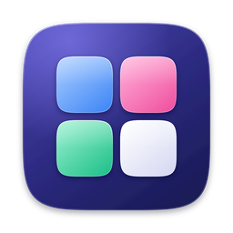

### `Cubbyhole`

Cubbyhole puts your web apps in one window. Gmail, Outlook, Slack, Teams, Discord, Google Chat or any website sit side by side, each in its own compartment with its own sign-in and its own Chrome extensions.

  <a href="https://github.com/semicolonconsulting/cubbyhole-release/releases/latest">
    Download
  </a>
  •
  <a href="https://github.com/semicolonconsulting/cubbyhole-release/releases">
    Release Notes
  </a>
  •
  <a href="https://github.com/semicolonconsulting/cubbyhole-release/issues">
    Feedback
  </a>

 

### What it does

- **One compartment per app.** Every service keeps its own cookies, sign-ins and storage, so you can add the same app several times for several accounts. Two services can share a compartment when you want, such as Gmail and Google Chat for the same Google account.
- **Chrome extensions, per app or for all.** Install extensions from the Chrome Web Store into one compartment only, or once for every compartment. Password managers such as Bitwarden fill in sign-ins as they do in Chrome.
- **A quiet window.** A slim side pane holds your apps with unread badges, and the toolbar stays hidden until you reach for the top edge. Pick the pane's color and your own image for any app's icon.
- **Mute everything with one click.** The bell in the side pane silences notifications from every app. You can also mute a single app.
- **Light on memory.** Apps start when you first open them, and mail apps left in the background go to sleep until you come back.

### Install

Download the latest release from [Releases](https://github.com/semicolonconsulting/cubbyhole-release/releases/latest):

- **macOS** (Apple Silicon): the `.dmg`. Open it and drag Cubbyhole onto Applications.
- **Windows**: the `.exe` installer.
- **Linux**: the `.AppImage` or the `.deb`.

Cubbyhole is free. The installers are not signed yet, so your system may warn you the first time you open the app. On macOS, if it refuses to open, run `xattr -cr /Applications/Cubbyhole.app` in Terminal once and open it again.

### Feedback

Bugs and ideas are welcome in [GitHub Issues](https://github.com/semicolonconsulting/cubbyhole-release/issues). This repository holds release files only. The source code is private.

### Privacy

Cubbyhole has no account, no analytics and no crash reports. Your sign-ins, cookies and settings stay on your computer.

It is built on Electron, not on Google Chrome, so the parts of Chrome that report to Google are not there: no usage statistics, no Google account sync of the browser, no Safe Browsing lookups of the pages you visit and no search suggestions.

What Cubbyhole does connect to:

- **The apps you add.** Each one talks to its own website, as it would in any browser. Gmail and Google Chat talk to Google because they are Google services.
- **The Chrome Web Store**, when you browse or install extensions, and afterwards to check your installed extensions for updates. The update check sends the extensions' IDs and versions to Google.
- **Google's download server, for spelling dictionaries**, on Windows and Linux. Turn off **Check spelling** in Settings to stop this. macOS uses the system's own spell checker instead.

Nothing else is contacted. We check this by recording the network traffic of a fresh install: on Linux the only connection besides the app you add is the dictionary download, and with Check spelling off there is none.

### More from Semicolon Consulting

- [Ctx Calendar](https://github.com/semicolonconsulting/ctxcalendar-releases): several client calendar accounts (Google, Outlook, iCloud) in one view.
- [Foliarium](https://github.com/semicolonconsulting/foliarium): tidies your Mac's folders by itself with a few rules.
- [Demo Pointer](https://github.com/semicolonconsulting/demopointer): hold ⌘ and a magnifying lens follows your cursor, for demos and screen shares.
- [Desktopcloth](https://github.com/semicolonconsulting/desktopcloth): hides the icons on your Mac's desktop with one click.

© Semicolon Consulting Inc.
